# Oracle CDC → Azure Databricks with Debezium

Change data capture from Oracle databases running on Kubernetes into a lakehouse on Azure Databricks. Debezium reads every insert, update and delete from Oracle's redo log, sends it to Azure Event Hubs, and Databricks turns the change stream into Delta tables.

| Step | Status |
|---|---|
| 1. Oracle running inside Kubernetes (minikube), reachable from a SQL client | Done |
| 2. Oracle prepared for CDC (archive log mode, supplemental logging, LogMiner user) | Done |
| 3. Debezium Server in Kubernetes → Azure Event Hubs | Done |
| 4. Event Hubs → Databricks Bronze → Silver Delta table | Done |
| 5. Monitoring: Prometheus + Grafana dashboard | Planned |

How it's built, how CDC works inside Oracle, and how to run everything: **[TECHNICAL.md](TECHNICAL.md)**

## Architecture

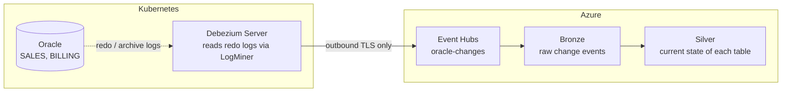

- **Oracle and Debezium run in the same Kubernetes cluster.** Only outbound connections leave it; nothing in Azure needs to reach into the cluster network.
- **Event Hubs** receives all change events in one event hub, partitioned by primary key so changes to the same row stay in order.
- **Databricks** stores the raw events (Bronze) and applies them to Delta tables that mirror the Oracle tables (Silver). One notebook on serverless compute does both; it reads Event Hubs through its Kafka endpoint.
- **Azure resources are defined in Terraform**: Event Hubs and the Databricks workspace in `infra/azure/`, the secret scope and notebook in `infra/databricks/`.

### What CDC captures

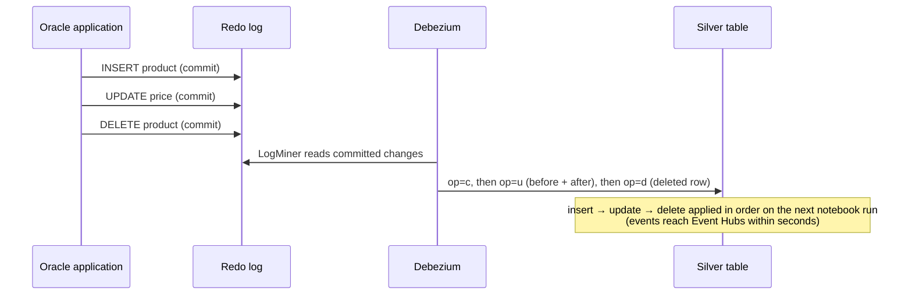

Every change arrives, including deletes, which leave no trace in the table itself. Each event carries the row's old and new values, so the target can apply them exactly.

### Capturing several schemas

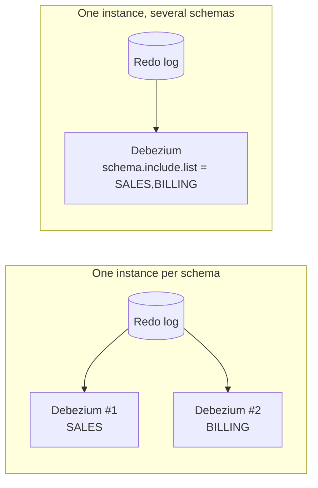

LogMiner reads the whole redo stream whatever the filter, so one connector with `schema.include.list` reads the redo once, while separate instances per schema each read it again.

## Design considerations

- **CDC changes the database setup.** Archive log mode needs a restart, so it needs a maintenance window. Archived logs need disk and a cleanup policy, and supplemental logging increases redo volume. Most production databases already run in archive log mode for backups or Data Guard; then only supplemental logging, which needs no restart, is new.
- **CDC runs next to the database.** Debezium needs network access to the Oracle listener; running it in the same cluster keeps that traffic internal. One instance per schema gives isolation (a failure or re-snapshot in one schema doesn't affect the others). One instance for several schemas halves the redo reads and pod count.
- **No Kafka cluster required.** Debezium Server writes straight to Event Hubs over outbound TLS, with the connection string stored as a Kubernetes Secret. It runs one connector per process, with no Kafka Connect workers or REST layer. Kafka Connect against the Event Hubs Kafka endpoint is the alternative when many connectors need central management.
- **Delivery is at-least-once.** After a restart, Debezium may resend events since its last stored position, so the Silver merge must be idempotent. It only applies an event that is newer (by partition offset) than the version already in Silver.
- **Streaming semantics, batch-like cost.** The Databricks streams use `availableNow`: each run processes everything new since its checkpoint and then stops. The same code runs continuously by changing only the trigger, once the latency requirement justifies always-on compute.
- **The sink's batching matters.** With `dynamicpartitionrouting=key` the Event Hubs sink sends roughly one batch per key, so an initial snapshot of the larger tables ran at about 27 events/s. The Kafka sink against the Event Hubs Kafka endpoint batches across keys.

## Scope and limitations

| Representative of a production setup | Different from a production setup |
|---|---|
| Oracle runs inside Kubernetes; Debezium runs in the same cluster | Oracle AI Database 26ai Free instead of Enterprise Edition |
| Database reachable only inside the cluster (ClusterIP) | Tiny datasets (≤ 100 rows per table), so every row can be followed end to end |
| Business schemas with primary keys, two schemas in one database | Debezium currently captures one table (`SALES.PRODUCTS`); more tables are a config change |

## Quick start

Requires Docker Desktop (≥ 8 GB memory), `minikube`, `kubectl`, a SQL client such as DBeaver, and for the Azure part `az` and `terraform`.

```bash
cp .env.example .env              # set the three passwords
./scripts/start.sh                # minikube + Oracle (first start: ~5–10 min)
./scripts/logminer-check.sh       # checks CDC readiness
(cd infra/azure && terraform init && terraform apply)        # Event Hubs + Databricks workspace
./scripts/deploy-debezium.sh      # Debezium Server → Event Hubs
(cd infra/databricks && terraform init && terraform apply)   # secret scope + notebook
# then run the notebook oracle-cdc/products_cdc on serverless compute
./scripts/connect.sh              # localhost:1521 → Oracle for DBeaver, keep it open
./scripts/stop.sh                 # stop, data is kept
```

DBeaver: `localhost:1521`, service name `FREEPDB1`, user `SALES`. Details in [TECHNICAL.md](TECHNICAL.md#running-it).

### Walkthrough: one change, end to end

One update, one insert and one delete in Oracle, followed through Kubernetes, Event Hubs and Databricks until Silver matches the source again.

**1. Source table in Oracle.** `SALES.PRODUCTS`, 10 rows.

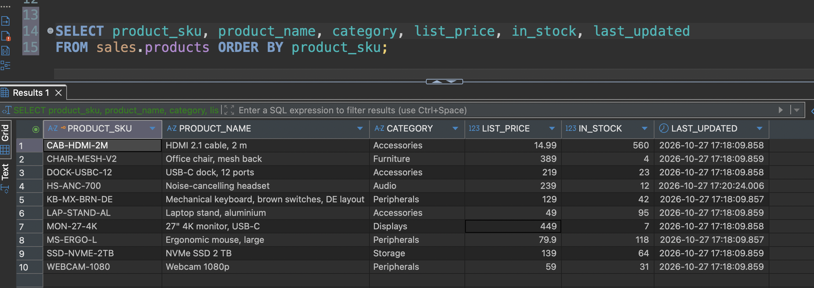

**2. Kubernetes.** One node; Oracle and Debezium run as separate pods in their own namespaces.

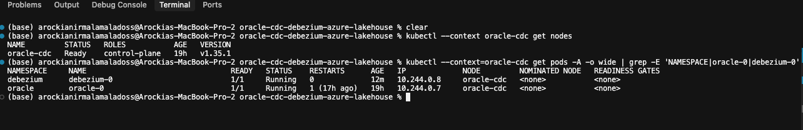

**3. Silver before the change.** Same 10 rows as Oracle. `_op = r` comes from the initial snapshot, `u` from an earlier update.

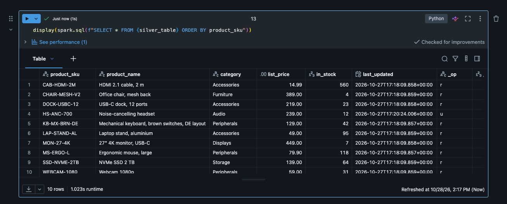

**4. Change the data in Oracle.** One transaction: a price update, a new product, a deleted product.

```sql
UPDATE sales.products SET list_price = 119.00 WHERE product_sku = 'KB-MX-BRN-DE';
INSERT INTO sales.products (product_sku, product_name, category, list_price, in_stock)
VALUES ('USB-HUB-7P', 'USB 3.2 hub, 7 ports', 'Accessories', 34.50, 12);
DELETE FROM sales.products WHERE product_sku = 'CAB-HDMI-2M';
COMMIT;
```

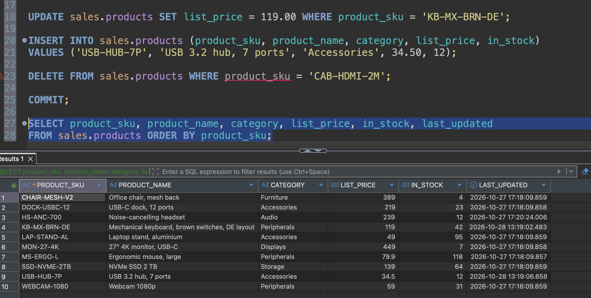

**5. The change events in Event Hubs.** Read through the Kafka endpoint a few seconds after the commit: one event per row, each in the partition of its primary key.

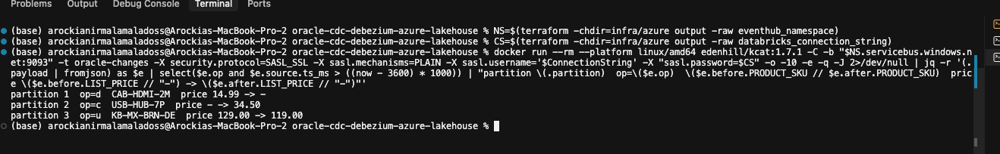

**6. Event Hubs in the Azure portal.** Hub `oracle-changes` with 4 partitions. Incoming messages are the heartbeats (one per minute) plus the three changes.

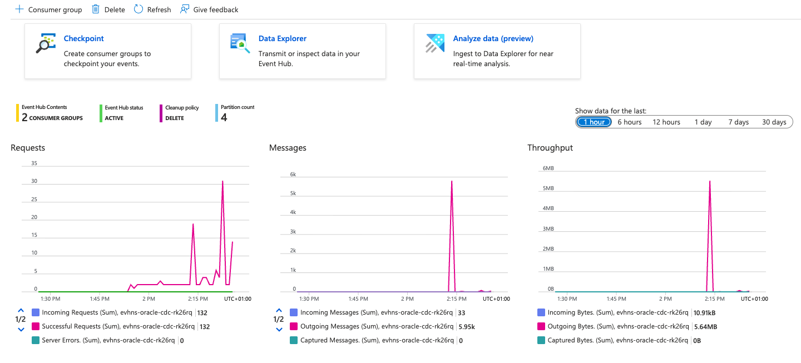

**7. One raw change event.** The update carries the full row `before` and `after`, plus its position in Oracle: SCN, commit SCN, transaction ID, schema and table.

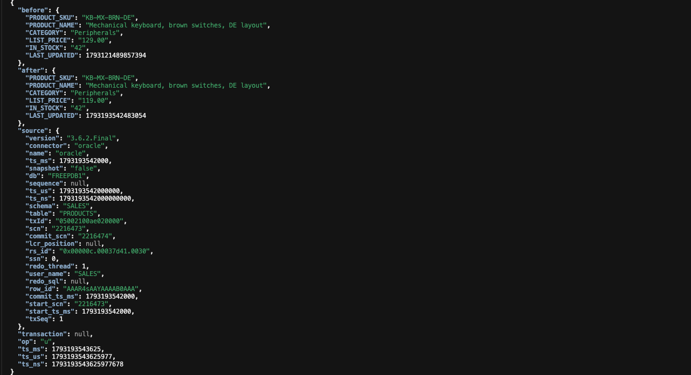

**8. The same event in the portal's Data Explorer.** Partition 3, enqueued at the time of the commit. The older rows above it are from an earlier run that captured all `SALES` tables.

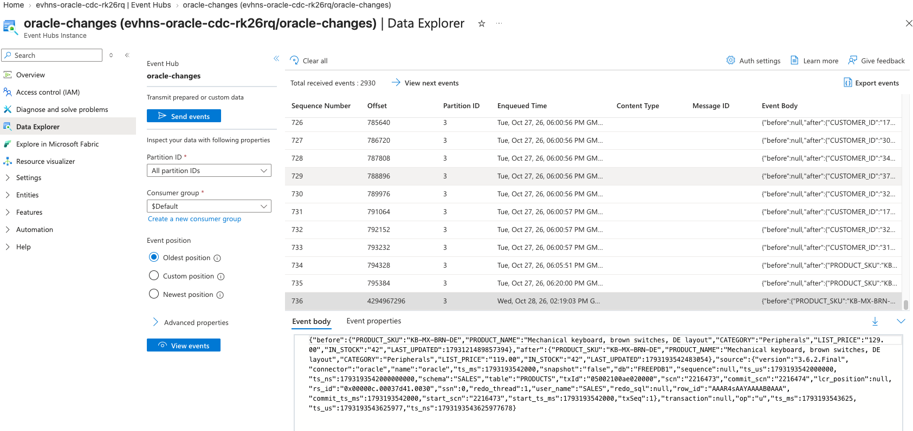

**9. Bronze.** Every event stored unchanged, with its partition, offset and enqueue time. The three new events are on top.

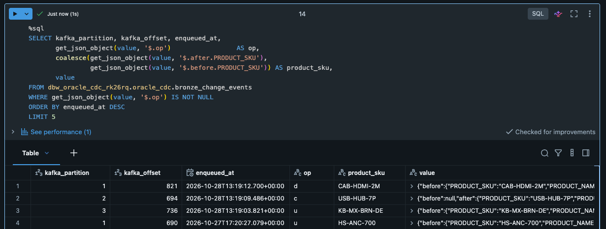

**10. Silver after the change.** Matches Oracle again: the price is updated, the new product is there, and the deleted product is gone.

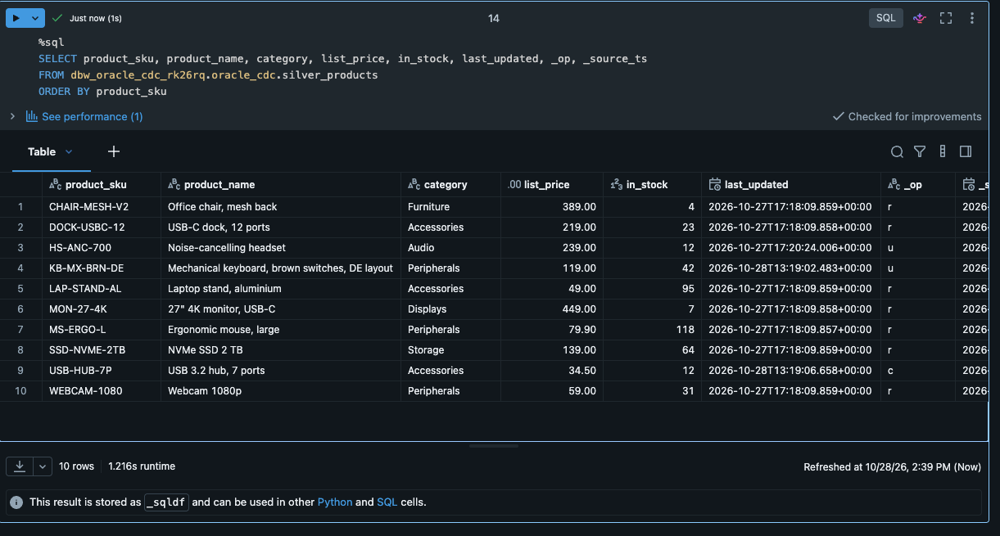
