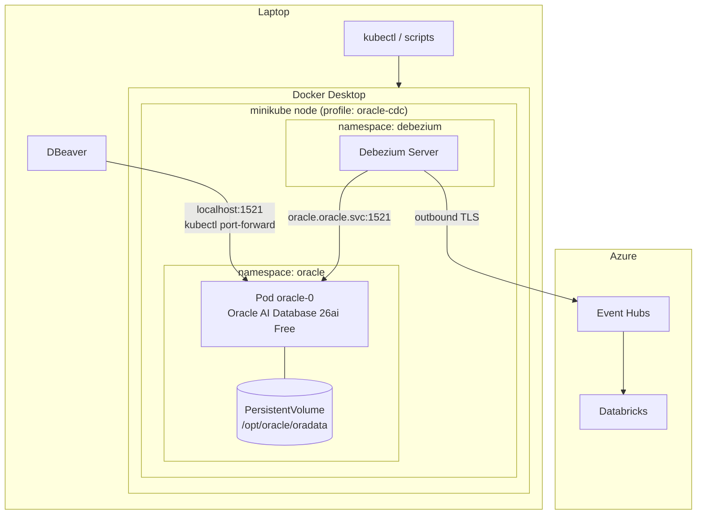
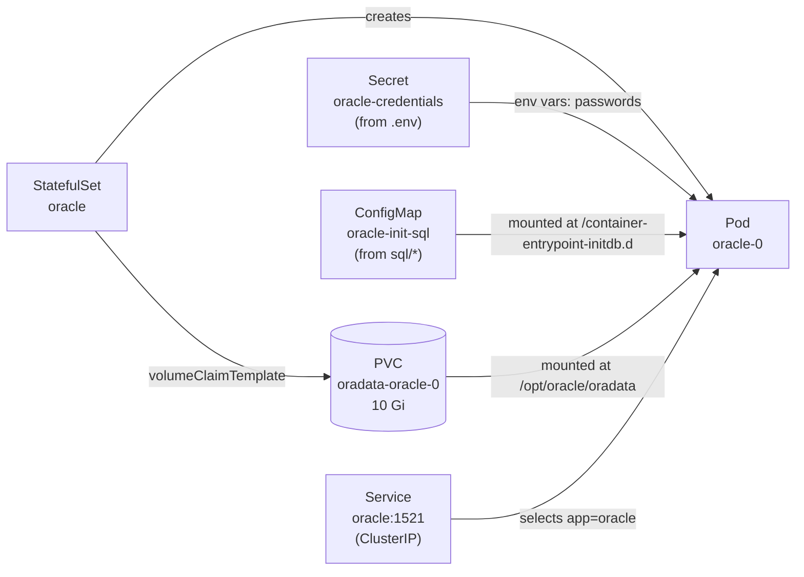
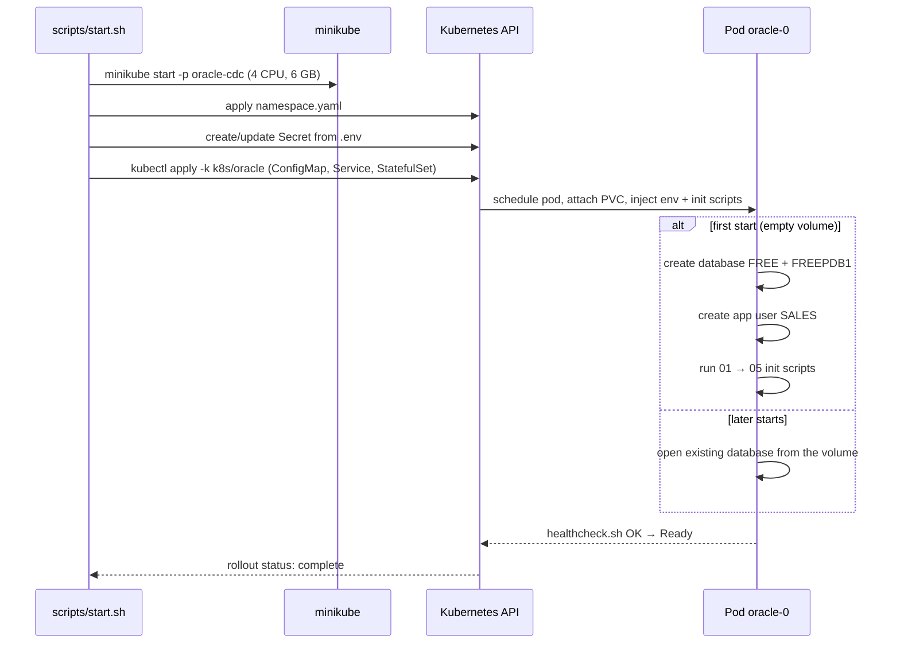
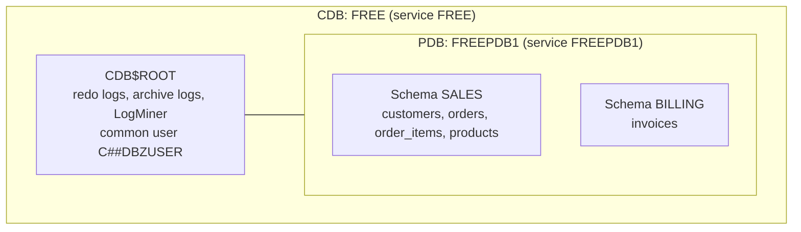
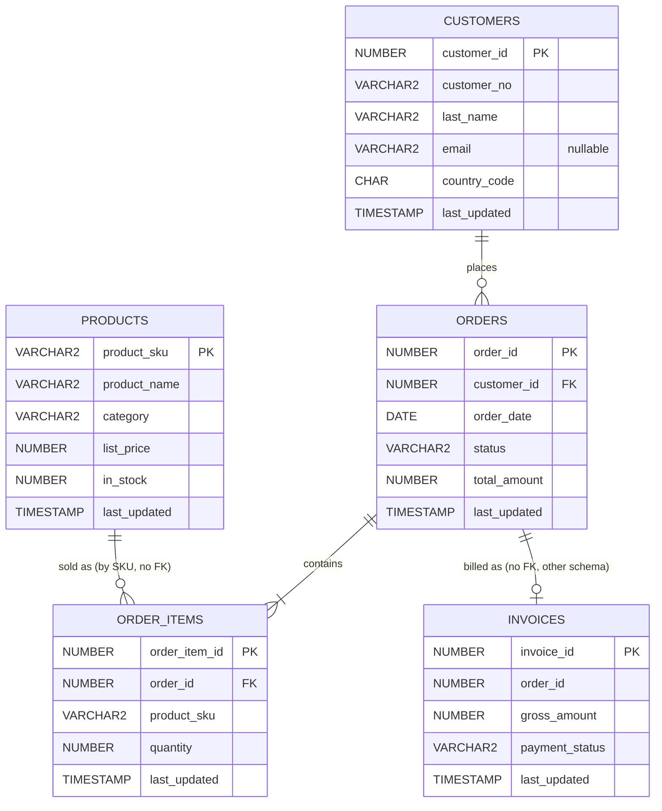
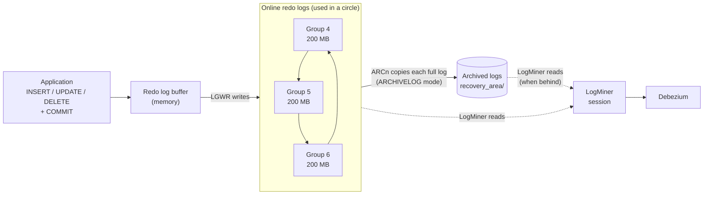
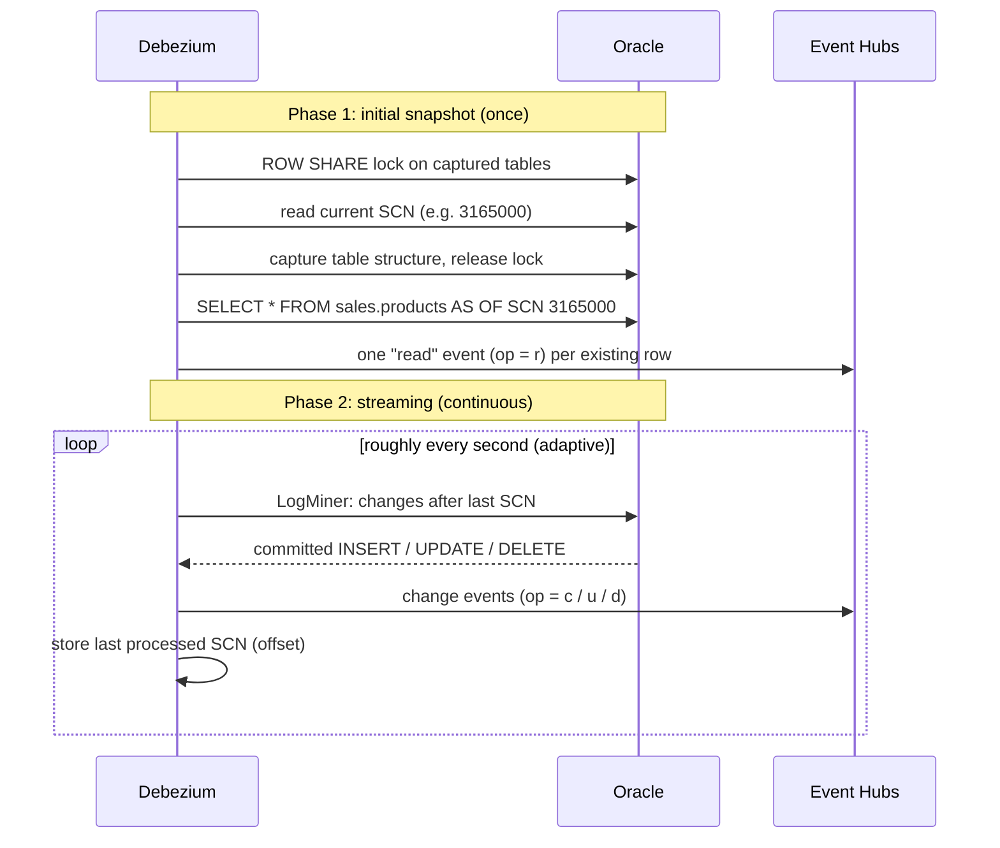
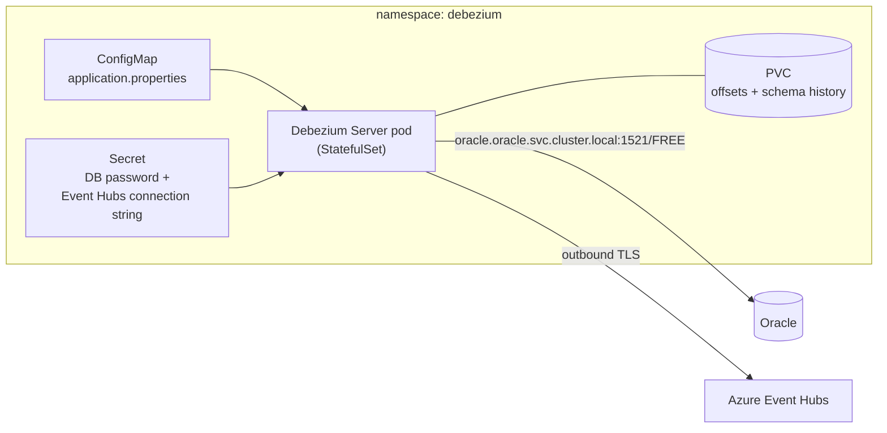
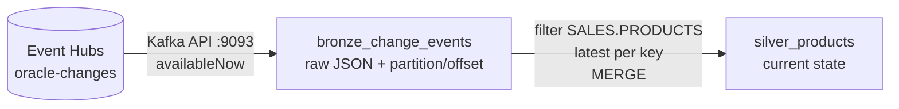

# Technical guide

How the environment is built, how Oracle records changes, how Debezium turns those changes into events, and how Databricks applies them to Delta tables.

1. [The big picture](#1-the-big-picture)
2. [Kubernetes building blocks](#2-kubernetes-building-blocks)
3. [What happens on start](#3-what-happens-on-start)
4. [Oracle inside the pod](#4-oracle-inside-the-pod)
5. [Data model](#5-data-model)
6. [How Oracle records changes](#6-how-oracle-records-changes)
7. [Preparing Oracle for CDC](#7-preparing-oracle-for-cdc)
8. [How Debezium works](#8-how-debezium-works)
9. [Databricks: Bronze and Silver](#9-databricks-bronze-and-silver)
10. [Running it](#running-it)
11. [Repository layout](#repository-layout)

---

## 1. The big picture



- **minikube** runs a one-node Kubernetes cluster inside a Docker container. The profile name `oracle-cdc` keeps it separate from any other local cluster.
- Everything for the database lives in the **`oracle` namespace**. Debezium gets its own namespace, the same separation you'd use in production (different owners, different permissions).
- The database is only reachable **inside the cluster**. Your laptop reaches it through a `kubectl port-forward` tunnel, not through an exposed port.

## 2. Kubernetes building blocks



| Object | File | What it does | Why this choice |
|---|---|---|---|
| Namespace `oracle` | `k8s/oracle/namespace.yaml` | Groups all database objects | One command to inspect or delete everything |
| StatefulSet `oracle` | `k8s/oracle/statefulset.yaml` | Runs exactly one Oracle pod | A database needs a stable name (`oracle-0`) and its *own* disk that follows it across restarts. A Deployment gives neither. |
| PersistentVolumeClaim | (generated by the StatefulSet) | 10 Gi disk for datafiles, redo logs, archive logs and config | Data survives pod restarts and `minikube stop` |
| Service `oracle` | `k8s/oracle/service.yaml` | Stable DNS name `oracle.oracle.svc.cluster.local:1521` | Pods get new IPs on restart; the Service name stays. ClusterIP = not exposed outside the cluster. |
| Secret `oracle-credentials` | created by `scripts/start.sh` from `.env` | `ORACLE_PASSWORD`, `APP_USER_PASSWORD`, `DBZ_PASSWORD` | Passwords never appear in a committed file |
| ConfigMap `oracle-init-sql` | generated by `k8s/oracle/kustomization.yaml` from `k8s/oracle/sql/` | Delivers the init scripts into the pod | The SQL stays in plain `.sql` files instead of being pasted into YAML |

**Probes.** The image ships a `healthcheck.sh` that reports whether the database is open.
- A **startupProbe** allows up to 10 minutes for the very first start, when the database is created and seeded.
- A **readinessProbe** then marks the pod ready or not ready. `kubectl rollout status` waits for exactly this signal.

**Resources.** Oracle Free limits itself to 2 CPUs and 2 GB of memory. The pod requests 1 CPU and 2 Gi, and is capped at 2 CPUs and 4 Gi. The minikube node has 4 CPUs and 6 GB, which leaves room for Debezium.

## 3. What happens on start



Init scripts run **only once**, when the volume is empty. Changing a file in `k8s/oracle/sql/` has no effect on an existing database until `scripts/reset.sh` wipes it.

## 4. Oracle inside the pod

Oracle uses a **multitenant** architecture: one container database (CDB) hosts one or more pluggable databases (PDBs). Applications live in a PDB. Some administrative work, including LogMiner, happens at the CDB level.



Redo logs belong to the **whole CDB**, not to one PDB or schema. That's why the Debezium user is a *common* user (`C##` prefix): it connects to the CDB to run LogMiner, then switches into `FREEPDB1` to read table data.

| User | Where | Used for | Login |
|---|---|---|---|
| `SYS` / `SYSTEM` | CDB | Administration | `ORACLE_PASSWORD` |
| `SALES` | FREEPDB1 | Application schema, DBeaver connection | `APP_USER_PASSWORD` |
| `BILLING` | FREEPDB1 | Second application schema | None (schema-only account); `SALES` has read/write grants |
| `C##DBZUSER` | CDB + all PDBs | Debezium / LogMiner | `DBZ_PASSWORD` |

**What's on the persistent volume** (`/opt/oracle/oradata`):

```
FREE/                 CDB datafiles + online redo logs (redo04-06.log, 200 MB each)
FREE/FREEPDB1/        PDB datafiles (SALES and BILLING data)
recovery_area/        archived redo logs (max 5 GB)
dbconfig/FREE/        spfile, password file, listener config
```

The datafiles already take about 4 GB, and the recovery area may grow to 5 GB, so the 10 Gi volume has little headroom. minikube's local storage doesn't enforce the size, but a real cluster would. Size production volumes as datafiles + recovery area + growth.

## 5. Data model



| Schema | Table | Rows |
|---|---|---|
| SALES | `customers` | 25 |
| SALES | `orders` | 40 |
| SALES | `order_items` | 86 |
| SALES | `products` | 10 (the table Debezium currently captures) |
| BILLING | `invoices` | 29 |

The datasets are deliberately tiny, so every row can be followed from Oracle to the Silver table. `c_customers` / `c_orders` in `02_seed_data.sql` scale them up.

Two properties matter for CDC:
- **Every table has a primary key.** Debezium uses it as the event key, so all changes to one row stay in order, provided the sink routes by key (Event Hubs sink: `dynamicpartitionrouting=key`).
- **Every table has `LAST_UPDATED`, maintained by a trigger**, as business applications typically do. It makes it easy to see in the target when a row last changed.

## 6. How Oracle records changes

Every change in Oracle is first written to the **redo log**, before the data files are touched. Redo exists for crash recovery, and it's also exactly what CDC reads.



- **Online redo logs** are reused in a circle. When one group is full, Oracle switches to the next one (a *log switch*).
- **Without ARCHIVELOG mode**, a full log is simply overwritten later. If Debezium is slower than the circle, those changes are lost.
- **With ARCHIVELOG mode**, every full log is first copied to the recovery area, so Debezium can catch up from there.
- **Supplemental logging** adds extra column values to the redo. Without it, an UPDATE record only contains the changed columns and an internal row address. With `ALL COLUMNS`, the unchanged columns are logged too, so an update event can show the full before and after state. (A DELETE already carries the whole row, because Oracle records it in undo.)
- **NOLOGGING operations are invisible.** Direct-path loads or other `NOLOGGING` operations write no row-level redo, so CDC never sees them. Production sources need `ALTER DATABASE FORCE LOGGING`, or confirmation that no such loads run.
- **LogMiner** is Oracle's built-in API for reading redo as rows (`V$LOGMNR_CONTENTS`). It always reads the full redo stream. Debezium can push schema/table filters into its LogMiner query (`log.mining.query.filter.mode`), but the redo is still read in full.

## 7. Preparing Oracle for CDC

`k8s/oracle/sql/04_cdc_setup.sh` applies these changes:

| Change | Why Debezium needs it | Cost on the database side |
|---|---|---|
| `ARCHIVELOG` mode + recovery area | Debezium reads archived redo logs when it falls behind the online logs | One restart; archived logs need disk and a cleanup job |
| Redo logs 2 × 20 MB → 3 × 200 MB | Every log switch restarts the LogMiner session; small logs mean constant overhead | Slightly more disk |
| Minimal supplemental logging (database) | Required for LogMiner to reconstruct row changes | Small redo increase |
| `ALL COLUMNS` supplemental logging (captured tables only) | Change events carry the full before/after row, including unchanged columns on UPDATE | More redo for those tables only |
| Common user `C##DBZUSER` | Runs LogMiner in the CDB, reads tables in the PDB | `SELECT`/`FLASHBACK` granted per table, not `ANY TABLE` |

Operational rules that follow:

- **Archive log retention must exceed the longest connector outage.** If Debezium restarts and the archived log it needs is gone, it has to re-snapshot. `scripts/purge-archivelogs.sh [hours]` deletes archived logs older than the given age (default 24 h).
- **A full recovery area blocks all DML** (`ORA-00257` archiver error) until space is freed. Without a backup strategy, nothing removes archived logs automatically. In production this belongs in the DBA's RMAN backup policy.

**Verify it without Debezium:**

```bash
./scripts/logminer-check.sh
```

The script inserts, updates and deletes one order as `SALES`, then reads those changes back from the redo log as `C##DBZUSER`:

```
INSERT  SALES.ORDERS  insert into "SALES"."ORDERS"("ORDER_ID","CUSTOMER_ID",...) values ('41','1',...);
UPDATE  SALES.ORDERS  update "SALES"."ORDERS" set "STATUS" = 'PAID', ... where "ORDER_ID" = '41' and ...
DELETE  SALES.ORDERS  delete from "SALES"."ORDERS" where "ORDER_ID" = '41' and "CUSTOMER_ID" = '1' and "STATUS" = 'PAID' and ...
```

The UPDATE's WHERE clause lists every column's old value, not just the changed one. That's `ALL COLUMNS` supplemental logging at work, and it lets Debezium emit a full `before` and `after` image for updates. The DELETE carries the whole removed row (Oracle takes it from undo), so the target knows exactly which row to remove.

## 8. How Debezium works

> Debezium Server is deployed from `k8s/debezium/` by `scripts/deploy-debezium.sh`. It currently captures `SALES.PRODUCTS`.

### Two phases: snapshot, then streaming



- **SCN** (System Change Number) is Oracle's logical clock. Every committed change has one. Debezium remembers the last SCN it processed (the *offset*) and resumes from there after a restart.
- The **snapshot** uses a flashback query (`AS OF SCN`), so all tables are read as of the same moment while the application keeps writing. That's why `C##DBZUSER` has the `FLASHBACK` grant. On very large tables this depends on enough **undo retention**. If the undo needed for the snapshot is overwritten, the query fails with `ORA-01555 snapshot too old`.
- **Streaming** continues from the snapshot SCN, so the handover has no gap.
- **Delivery is at-least-once.** After a crash, events since the last stored offset are sent again, so the Silver merge must be idempotent.

### What a change event looks like

A DELETE of one product (shortened):

```json
{
  "op": "d",
  "before": {
    "PRODUCT_SKU": "HS-ANC-700", "PRODUCT_NAME": "Noise-cancelling headset",
    "CATEGORY": "Audio", "LIST_PRICE": "249.00", "IN_STOCK": "0", "LAST_UPDATED": 1793117530010872
  },
  "after": null,
  "source": {
    "connector": "oracle", "db": "FREEPDB1", "schema": "SALES", "table": "PRODUCTS",
    "scn": "3165432", "commit_scn": "3165440", "txId": "0a001b00f4030000"
  },
  "ts_ms": 1793117530123
}
```

Type mapping to keep in mind downstream:
- Under `decimal.handling.mode=string` every `NUMBER` column arrives as a JSON string in this setup: unconstrained `NUMBER` (like `ORDER_ID`), `NUMBER(10,2)` and also `NUMBER(5)` (`"IN_STOCK": "64"`). Reading such a field as `INT` in Spark's `from_json` silently gives `NULL`, so Silver reads it as a string and casts.
- `DATE` arrives as epoch **milliseconds**, `TIMESTAMP(6)` as epoch **microseconds**. Mixing the two up is a common Silver-layer bug.

| `op` | Meaning | `before` | `after` |
|---|---|---|---|
| `r` | row read during snapshot | null | row |
| `c` | insert | null | new row |
| `u` | update | old row | new row |
| `d` | delete | deleted row | null |

Downstream, the Silver layer applies these events in partition-offset order (all changes to one row share a partition): insert/update → upsert, delete → delete. The result is a Delta table that mirrors the Oracle table.

### Deployment in Kubernetes



- **Debezium Server** is a single Java process: Oracle connector in, a sink out. It runs one connector per process, with no Kafka Connect workers or REST layer, which keeps the footprint small (one JVM, no Connect workers). Kafka Connect against the Event Hubs Kafka endpoint is the alternative when many connectors need central management.
- **It's stateful.** It has to remember the last SCN (offsets) and the table structures it has seen (schema history). Both go on a small persistent volume, so it also runs as a StatefulSet. Without them, every restart would trigger a full re-snapshot.

### Azure resources (Terraform, `infra/azure/`)

```
rg-oracle-cdc                                   resource group, Germany West Central
└── evhns-oracle-cdc-<suffix>                   Event Hubs namespace, Standard, 1 throughput unit
    └── oracle-changes                          one event hub for all tables, 4 partitions, 7 days retention
        ├── debezium-send       (send only)     key used by Debezium Server
        ├── databricks-listen   (listen only)   key used by Databricks
        └── databricks                          consumer group for the Databricks stream
└── dbw-oracle-cdc-<suffix>                     Databricks workspace, SKU premium (Unity Catalog), Sweden Central
    ├── secret scope oracle-cdc                 holds the listen-only Event Hubs key
    └── notebook ~/oracle-cdc/products_cdc      Bronze + Silver for SALES.PRODUCTS (§9)
rg-oracle-cdc-dbw-<suffix>-managed              created and managed by Databricks (storage, network, VMs)
```

The workspace itself is in `infra/azure/`. Everything inside it (secret scope, secret, notebook) is in `infra/databricks/`, because the Databricks provider can only plan against a workspace that already exists. `infra/databricks/` reads the workspace URL and the Event Hubs key from `infra/azure/`'s state, and authenticates with the same `az login` session.

- **One hub for all tables.** A Standard namespace allows only 10 event hubs, and every event names its schema and table in `source`. Events are partitioned by primary key, so changes to one row stay in order.
- **Standard, not Basic.** Basic has no Kafka endpoint, and Databricks' built-in Kafka source needs one. Debezium writes over AMQP, Databricks reads over Kafka; Event Hubs translates between the two.
- **Separate send and listen keys.** A leaked Debezium key can't read data, and a leaked Databricks key can't inject changes.
- **Workspace in a different region.** On this subscription type every 4-vCPU VM size in Germany West Central is restricted (`NotAvailableForSubscription`), so classic cluster VMs can't start there. That's how the workspace ended up in Sweden Central (`databricks_location`), and Event Hubs stays where it is. The few events that cross regions don't matter. The notebook now runs on serverless compute, which doesn't use the subscription's VM sizes or quota; the check below still matters for classic clusters. To see which sizes a region allows, query the SKU API with a server-side region filter (`az vm list-skus` downloads the global list first and is very slow):

  ```bash
  SUB=$(az account show --query id -o tsv)
  az rest --method get \
    --url "https://management.azure.com/subscriptions/$SUB/providers/Microsoft.Compute/skus?api-version=2021-07-01&\$filter=location eq 'swedencentral'" \
    --query "value[?resourceType=='virtualMachines' && length(restrictions)==\`0\` && capabilities[?name=='vCPUs' && value=='4']].name" -o tsv
  az vm list-usage -l swedencentral -o table    # vCPU quota per family
  ```

```bash
cd infra/azure
export ARM_SUBSCRIPTION_ID=$(az account show --query id -o tsv)
terraform init && terraform plan && terraform apply

cd ../databricks             # after infra/azure is applied
terraform init && terraform plan && terraform apply

# tear down in reverse order
terraform -chdir=infra/databricks destroy
terraform -chdir=infra/azure destroy
```

**Two ways to reach Event Hubs** (this project uses the Event Hubs sink):

| | Event Hubs sink | Kafka sink → Event Hubs Kafka endpoint |
|---|---|---|
| Protocol / port | AMQP over TLS (5671) | Kafka over TLS (9093) |
| Event Hubs tier | Basic and above | Standard and above |
| Routing | One event hub; partition by key with `dynamicpartitionrouting=key` | One topic per table by default (re-routable with a topic-routing transform) |
| Limits to know | Basic: 256 KB per event, 1 consumer group, 1-day retention, no Kafka API | Standard: 10 event hubs per namespace, so one hub per table doesn't scale |
| Consumer in Databricks | Event Hubs connector or Kafka API | Kafka source (`readStream.format("kafka")`) |

### Verify the stream end to end

Change a product in Oracle (DBeaver or SQL*Plus as `SALES`):

```sql
UPDATE products SET list_price = 239.00, in_stock = 12 WHERE product_sku = 'HS-ANC-700';
COMMIT;
```

Read the event hub with `kcat` (runs in a throwaway container; uses the listen-only key from Terraform). The key is passed as a `docker run` argument, which is acceptable for a local check with a read-only key but not for anything long-running:

```bash
NS=$(terraform -chdir=infra/azure output -raw eventhub_namespace)
CS=$(terraform -chdir=infra/azure output -raw databricks_connection_string)
docker run --rm edenhill/kcat:1.7.1 -C -b "$NS.servicebus.windows.net:9093" -t oracle-changes \
  -X security.protocol=SASL_SSL -X sasl.mechanisms=PLAIN \
  -X sasl.username='$ConnectionString' -X "sasl.password=$CS" \
  -o beginning -e -q -f '%p\t%k\t%s\n' | grep HS-ANC-700
```

Result (formatted): the snapshot row, then the update with before and after values, all in the same partition because the primary key is the partition key:

```
partition 1 | op r | price None   -> 249.00 | stock None -> 0
partition 1 | op u | price 249.00 -> 239.00 | stock 0    -> 12
```

To list only recent changes, one line each (`-J` wraps every event in JSON with its partition; heartbeats have no `op` and are dropped):

```bash
docker run --rm --platform linux/amd64 edenhill/kcat:1.7.1 -C \
  -b "$NS.servicebus.windows.net:9093" -t oracle-changes \
  -X security.protocol=SASL_SSL -X sasl.mechanisms=PLAIN \
  -X sasl.username='$ConnectionString' -X "sasl.password=$CS" \
  -o -10 -e -q -J 2>/dev/null \
| jq -r '(.payload | fromjson) as $e
    | select($e.op and $e.source.ts_ms > ((now - 3600) * 1000))
    | "partition \(.partition)  op=\($e.op)  \($e.before.PRODUCT_SKU // $e.after.PRODUCT_SKU)  price \($e.before.LIST_PRICE // "-") -> \($e.after.LIST_PRICE // "-")"'
```

```
partition 1  op=d  CAB-HDMI-2M  price 14.99 -> -
partition 2  op=c  USB-HUB-7P  price - -> 34.50
partition 3  op=u  KB-MX-BRN-DE  price 129.00 -> 119.00
```

For a single event in full, read one partition (`-p 3 -o -3 -f '%s\n'`) and pretty-print it with `jq 'select(.op == "u")'`. Without Docker, the Azure portal shows the same events: event hub → **Data Explorer** → **View events**, consumer group `$Default`.

Offsets differ by tool: through the Kafka endpoint, Event Hubs exposes the event's **sequence number** as the Kafka offset. Data Explorer shows both, and its *Sequence Number* column is what Bronze stores as `kafka_offset`.

**SCNs are only comparable within one database.** After the database is re-created, its SCN counter starts lower again, while events from the old database are still in the hub (7 days retention). Consumers therefore start reading at the current Debezium deployment's start time instead of at the beginning of the hub.

**Connector settings to get right:**

| Setting | Value | Why |
|---|---|---|
| `database.dbname` / `database.pdb.name` | `FREE` / `FREEPDB1` | Connect to the CDB, capture from the PDB |
| `schema.include.list` / `table.include.list` | `SALES` / `SALES.PRODUCTS` | Currently one table; `SALES,BILLING` plus the table list captures both schemas with one instance |
| `decimal.handling.mode` | `string` | Oracle `NUMBER` otherwise arrives as binary-encoded decimals that are awkward to read downstream |
| `tombstones.on.delete` | `false` | Tombstones only matter for compacted event hubs; this design doesn't use compaction, so they'd only be noise in Bronze |
| `heartbeat.interval.ms` | e.g. `60000` | Keeps the offset moving when captured tables are quiet, so archived logs can be purged safely |

## 9. Databricks: Bronze and Silver

One notebook, `databricks/products_cdc.py`, runs both layers on serverless compute. `terraform -chdir=infra/databricks apply` uploads it to `~/oracle-cdc/products_cdc` in the workspace, so the repo file is the source of truth.



Tables live in the workspace's default Unity Catalog catalog, schema `oracle_cdc`. Stream checkpoints are in the volume `oracle_cdc.checkpoints`.

| Step | What it does | Why |
|---|---|---|
| Bronze | Kafka source → key/value as text, plus partition, offset, enqueue time | Keeps every event unchanged, so Silver can be rebuilt without Oracle |
| Start position | `startingTimestamp` = current Debezium start (widget `start_from`), first run only | The hub still holds events from earlier database instances (see the SCN note in §8) |
| Trigger | `availableNow` on both streams | Each run processes what's new and stops: batch-like cost, streaming semantics and checkpoints |
| Filter | `source.table = 'PRODUCTS'` and `op` present | Heartbeats and the table-structure (DDL) event from the snapshot share the hub and have no `op` |
| Types | `LIST_PRICE` string → `DECIMAL(10,2)`, `IN_STOCK` string → `INT`, `LAST_UPDATED` µs → `TIMESTAMP` | `decimal.handling.mode=string` and Oracle `TIMESTAMP(6)` |
| Ordering | latest event per key by Kafka offset | Debezium routes by primary key, so all changes to one row are in one partition, in commit order |
| MERGE | delete on `op = d`, update/insert otherwise, only if the offset is newer than the stored one | Delivery is at-least-once; a replayed event changes nothing |

**Serverless instead of a classic cluster.** A single-node classic cluster (4 vCPUs) takes about 5 minutes to start and keeps billing until it auto-terminates after at least 10 idle minutes. Serverless notebook compute starts in seconds, bills only while cells run, and doesn't count against the subscription's vCPU quota. For short `availableNow` runs that's both cheaper and simpler. Classic clusters remain the choice when the network path must stay inside your own VNet (VNet injection, private endpoints).

The MERGE uses Delta's Python API (`DeltaTable.merge`) on the micro-batch's own session. A temp view plus `spark.sql` inside `foreachBatch` lost the Spark session on serverless.

Lakeflow declarative pipelines (`AUTO CDC` / `APPLY CHANGES`) do the same Silver step declaratively. The explicit `foreachBatch` MERGE shows each step (ordering, deletes, replay guard) in plain code.

**Run it:**

1. `terraform -chdir=infra/databricks apply` (uploads the notebook).
2. Open the URL from `terraform -chdir=infra/databricks output -raw notebook_url`, select **Serverless** as compute (newest environment version), and choose **Run all**.
3. Silver shows the 10 products. Change a row in Oracle, run the notebook again, and the change appears. Deletes remove the row.

First run, Bronze per table and op:

| source_table | op | events | meaning |
|---|---|---|---|
| — | — | 99 | heartbeats (one per minute) |
| PRODUCTS | — | 1 | table structure, captured with the snapshot |
| PRODUCTS | r | 10 | initial snapshot |
| PRODUCTS | u | 1 | price/stock update on `HS-ANC-700` |

Silver: 10 rows, `HS-ANC-700` with the updated price.

End-to-end test: one transaction with an update (`KB-MX-BRN-DE`), an insert (`USB-HUB-7P`) and a delete (`CAB-HDMI-2M`). The three events reached Event Hubs within seconds of the commit, in partitions 3, 2 and 1. After the next notebook run Silver matched Oracle row for row, with the deleted row removed. The README walkthrough shows each step.

To rebuild Silver from Bronze, drop `silver_products` and delete `checkpoints/silver_products` in the volume:

```python
spark.sql(f"DROP TABLE IF EXISTS {silver_table}")
dbutils.fs.rm(f"{checkpoints}/silver_products", True)
```

The next run replays every Bronze event through the MERGE. This was needed once, after `IN_STOCK` had been parsed as `INT` and landed as `NULL` (see the type mapping in §8).

## Running it

**Requirements:** Docker Desktop (≥ 8 GB memory under Settings → Resources), `minikube`, `kubectl`, and a SQL client such as DBeaver. For the Azure part: `az` (Azure CLI, logged in) and `terraform`.

### 1. Set the passwords (once)

```bash
cp .env.example .env     # then set the three passwords in .env
```

### 2. Start Kubernetes and Oracle

```bash
./scripts/start.sh
```

This starts the minikube cluster `oracle-cdc`, deploys Oracle into the namespace `oracle`, and waits until the database is ready.
The **first start takes about 5–10 minutes** while the database is created, seeded and prepared for CDC. Later starts take about a minute.

### 3. Forward the database port

```bash
./scripts/connect.sh     # keep this terminal open
```

### 4. Connect with DBeaver

New connection → **Oracle**:

| Field | Value |
|---|---|
| Host | `localhost` |
| Port | `1521` |
| Database | `FREEPDB1` (choose **Service Name**, not SID) |
| Username | `SALES` |
| Password | `APP_USER_PASSWORD` from `.env` |

```sql
SELECT COUNT(*) FROM sales.orders;                          -- 40
SELECT * FROM billing.invoices FETCH FIRST 10 ROWS ONLY;
```

For administration, connect as `SYSTEM` with `ORACLE_PASSWORD`.

### 5. Stop, restart, reset

| Action | Command | Data |
|---|---|---|
| Stop (frees CPU and memory) | `./scripts/stop.sh` | kept |
| Start again | `./scripts/start.sh`, then `./scripts/connect.sh` | kept |
| Start from scratch | `./scripts/reset.sh`, then `./scripts/start.sh` | **deleted** and re-created |

### Useful commands

```bash
kubectl --context oracle-cdc -n oracle get pods            # oracle-0 should be Running, 1/1 READY
kubectl --context oracle-cdc -n oracle logs -f oracle-0    # database log, incl. first-start progress
kubectl --context oracle-cdc -n oracle exec -it oracle-0 -- sqlplus sales@FREEPDB1   # SQL*Plus inside the pod
./scripts/logminer-check.sh                                 # verify CDC readiness
./scripts/purge-archivelogs.sh 24                           # delete archived logs older than 24 h
```

### Troubleshooting

| Symptom | Cause | Fix |
|---|---|---|
| Pod `Pending` for a few seconds after a fresh start | Storage provisioner still creating the volume | Wait; it resolves itself |
| Pod `CreateContainerConfigError` | A key is missing from `.env` / the Secret | Compare `.env` with `.env.example`, run `start.sh` again |
| DBeaver: connection refused | `connect.sh` not running | Start `./scripts/connect.sh` and keep it open |
| `connect.sh`: port 1521 already in use | Another local Oracle or tunnel | `./scripts/connect.sh 15210` and use port 15210 in DBeaver |
| Changed SQL in `k8s/oracle/sql/` has no effect | Init scripts only run on an empty volume | `./scripts/reset.sh`, then `./scripts/start.sh` |
| Classic cluster: "The VM size you are specifying is not available" | The size is restricted for the subscription in the workspace region | Use serverless, or pick an unrestricted size/region with the SKU query in §8 |
| `debezium-0` stays `0/1` after the laptop slept or the cluster was stopped; log repeats `onTransportError … proton:io` | The AMQP connection to Event Hubs went stale; the network itself is fine | `kubectl --context oracle-cdc -n debezium rollout restart statefulset/debezium`. Offsets are on the PVC, so it resumes at its last SCN without a new snapshot |
| A Silver column is `NULL` although Oracle has values | The field arrives as a JSON string but is parsed as a number (`from_json` returns `NULL` silently) | Read it as `STRING` and cast; then rebuild Silver from Bronze (§9) |
| Serverless: "Spark session … is no longer usable" | Session dropped (seen with the old environment version 1) | Pick the newest environment version in the notebook's Environment panel, then run again; checkpoints make reruns safe |

## Repository layout

```
infra/azure/              Terraform: resource group, Event Hubs, Databricks workspace
infra/databricks/         Terraform: secret scope + Event Hubs key, notebook upload (applied after infra/azure)
databricks/products_cdc.py  notebook: Event Hubs → Bronze → Silver MERGE for SALES.PRODUCTS
docs/screenshots/         images for the README walkthrough (Oracle → Event Hubs → Bronze → Silver)
k8s/oracle/               Kubernetes manifests: namespace, StatefulSet, Service, kustomization
k8s/oracle/sql/           Run once, in order, when the database is first created
  01_sales_schema.sql       SALES tables, primary keys, LAST_UPDATED triggers
  02_seed_data.sql          customers, orders, order items
  03_billing_schema.sql     BILLING schema and invoices
  04_cdc_setup.sh           archive log mode, redo logs, supplemental logging, LogMiner user
  05_products.sql           10-row product catalog, the table used to test the pipeline
k8s/debezium/             Debezium Server: namespace, StatefulSet, application.properties, kustomization
scripts/
  start.sh / stop.sh        start or stop the cluster (data is kept)
  connect.sh                port-forward localhost:1521 → Oracle
  reset.sh                  delete the cluster and all data
  logminer-check.sh         check CDC readiness by reading changes from the redo log
  purge-archivelogs.sh      delete old archived redo logs
  deploy-debezium.sh        create the Debezium secret (from .env + Terraform) and deploy Debezium Server
  common.sh                 shared settings (profile, namespace)
.env.example              password template (copy to .env)
```
